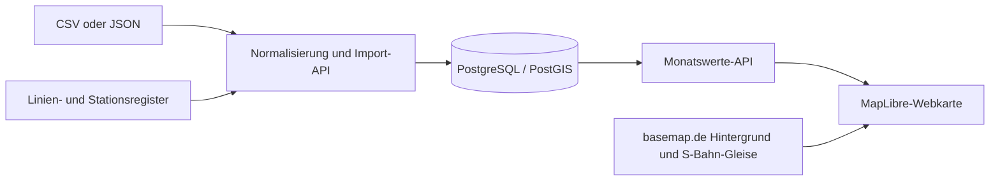

# trainmaps: monatliche Pünktlichkeitskarte und API

Stand 0.10.0, 1. Oktober 2026. Entwicklungs-API und bundesweite Webkarte sind
implementiert. Die Karte zeigt S1 bis S8 und S20 in München; Bedienung und Kartenendpunkte
stehen unter [Webkarte](KARTE.md). Verbindliche Anleitung der API-Endpunkte:
[API.md](API.md). Die vollstaendige Datei `daten/frontend.json` wurde geprueft
und unveraendert als Entwicklungsrevision 1 gespeichert. Der Internetzugang
ist unter **https://34.7.91.18** mit einem Let's-Encrypt-Zertifikat eingerichtet.
Die gesamte Dokumentation steht unter [Dokumentation](https://34.7.91.18/dokumentation).

Der Export enthaelt 33.108 Zeilen mit Puenktlichkeits- und Ausfallstatistiken
fuer 57 Monatslabels, 18 Netzbezeichnungen und 361 noch zu pruefende
Netz-/Linienkennungen. Eine separate Stations-Ausfallrangliste ist enthalten.
Die ergänzende CSV liefert Stationsnamen und EVA-Nummern; Zeitraum und eigene
Koordinaten fehlen weiterhin. Details: [Datenpruefung](DATENPRUEFUNG.md).

## Aussagekraft der vorhandenen Daten

Ausfälle zählen laut Quelle nicht mit: `cancellation_handling: excluded`.
Die Kartenlegende muss „Ausfälle nicht enthalten“ anzeigen. Die Puenktlichkeitszahlen erlauben keine Zuverlaessigkeitsquote ueber alle
geplanten Fahrten. Der vollstaendige Export liefert Ausfallquoten als separate
Kennzahl mit eigener Grundgesamtheit.

Die Daten enthalten kumulierte Monatsquoten je Netz und Linie, keine Stationswerte
und keine durchschnittlichen Verspätungsminuten. `n_data_points` wird zunächst
neutral als Messpunktzahl bezeichnet; die Quelle muss erklären, ob einzelne
Fahrten oder Haltereignisse gezählt werden.

| Kriterium | Erfüllende Messpunkte | Quote |
| --- | ---: | ---: |
| 2 Minuten | 9.795 | 95,0694 % |
| 5 Minuten | 10.186 | 98,8644 % |
| 10 Minuten | 10.269 | 99,6700 % |
| 20 Minuten | 10.301 | 99,9806 % |
| 40 Minuten | 10.303 | 100 % |

Alle Quoten stimmen mit `n_on_time_X / 10303` überein. Beim 5-Minuten-Kriterium
liegen 117 Messpunkte außerhalb, entsprechend 1,1356 %. Die kumulierten Quoten
dürfen nicht addiert werden. Ob „unter“ oder „höchstens“ die Grenze gilt, ist offen.
Differenzen benachbarter Zähler ergeben grobe Klassen (391, 83, 32 und 2),
aber keinen exakten Mittelwert oder exakte Perzentile in Minuten.

Die ganze Linie kann nach ihrer Monatsquote eingefärbt werden. Unterschiedliche
Stationsfarben, Problemabschnitte und Verspätungsaufbau A→B sind daraus nicht
ableitbar. Auch Stations-Monatsquoten würden keine Fahrzeitverluste zwischen
Stationen belegen; dafür braucht es gepaarte Ereignisse derselben Fahrt oder
bereits korrekt berechnete Segmentstatistiken.

## Architektur

Eigene trainmaps-Webkarte mit MapLibre GL JS und basemap.de Web Vektor als
Hintergrund. JSON geht an unsere API; eigene Layer zeigen Linien und Stationen.
Der öffentliche Viewer ist die Darstellungsreferenz, kein geplanter Upload-Endpunkt.
Der graue Standardstil dient als Ausgangspunkt für einen eigenen, gezielt
reduzierten trainmaps-Stil. Er wird nicht unverändert dargestellt:

<https://sgx.geodatenzentrum.de/gdz_basemapde_vektor/styles/bm_web_gry.json>

Quelle: [basemap.de Web Vektor](https://basemap.de/produkte-und-dienste/web-vektor/).

Aus der Analyse bleiben stabile IDs, versionierte Fahrwege und die Trennung
von Geometrie und Statistik bestehen. Die vorgeschlagene eigene OSM-Basiskarte
wird durch basemap.de ersetzt. Für einen regionalen Prototyp genügt begrenztes
GeoJSON; größere Netze erhalten eigene MVT-Tiles, optional in PMTiles. Echtzeit,
Kafka und eine eigene Live-Erfassung sind für diese Monatsdaten nicht erforderlich.

## Kartenansicht und Layerauswahl

Die Karte startet mit dem Profil „Minimal“: S-Bahnlinien mit Linienkennungen,
dezenten Ortsnamen und Gewässern auf hellem Hintergrund. S-Bahnlinien bilden die
visuell dominierende Ebene. Über eine kompakte Schaltfläche „Kartenebenen“ kann
der Nutzer selbst bestimmen, welche verfügbaren Layer angezeigt werden.
Autobahnen und zusätzliche Inhalte sind standardmäßig ausgeschaltet, können
aber ausdrücklich zugeschaltet werden.

| Auswahl | Standard | Verhalten |
| --- | --- | --- |
| S-Bahnlinien | Ein | Kräftige Linien, mit dem Zoom angepasste Strichstärke und kontrastierende Kontur. Die ausgewählte Linie wird zusätzlich betont. |
| Linienkennungen | Ein | Lesbare Bezeichnungen wie S1 und S7; bei ausgeblendeten S-Bahnlinien ebenfalls unsichtbar. |
| Kennzahlenfarben | Ein | Relative Farbe nach Mittelwert, Minimum, Maximum oder letztem Monatswert der gewählten Kennzahl. Die Skala umfasst die tatsächlich vorhandenen Linienwerte. |
| Ortsnamen | Ein | Dezente, zoomabhängige Beschriftung zur Orientierung. |
| Gewässer | Ein | Zurückhaltende Flächen und Linien. |
| Verwaltungsgrenzen | Aus | Optional zuschaltbare Orientierung. |
| Autobahnen | Aus | Optional mit allen zugehörigen Konturen, Brücken-/Tunnelvarianten und Beschriftungen. |
| Übrige Straßen | Aus | Separat zuschaltbar, ohne damit automatisch Autobahnen einzuschalten. |

Zusätzliche Gruppen wie Gebäude, Gelände, POIs oder andere Verkehrsnetze bleiben
zunächst außerhalb des MVP. Sie können später unter „Weitere Ebenen“ ergänzt
werden, soweit geeignete Daten vorliegen. Es gibt keine funktionslosen Schalter
für nicht verfügbare Ebenen. Stationslayer sind ebenfalls eine spätere Erweiterung:
Stammdaten würden zunächst nur neutrale Orientierungspunkte ermöglichen; eine
Pünktlichkeitsfarbe je Station erfordert zusätzlich eigene Stationsmesswerte.

Die Layerauswahl verwendet verständliche Gruppennamen und Checkboxen statt
technischer Layer-IDs. „Auf Minimal zurücksetzen“ stellt die obigen Standardwerte
wieder her. Die Auswahl wird lokal im Browser gespeichert. Monats-, Schwellen-,
Netz- und Stilwechsel erhalten sie. Auf Smartphones öffnet die Auswahl ein
einklappbares Panel. Legende und Quellenvermerk bleiben zugänglich; bei
abgeschalteten Pünktlichkeitsfarben erklärt die Ansicht die neutrale Darstellung.

Unsere S-Bahn-Fahrwege werden aus dem basemap.de-Layer `Verkehrslinie` mit der
Klasse `S-Bahn` ausgewählt und im eigenen Linienregister versioniert referenziert.
Überlagerte S-Bahnlinien werden über Filter, Darstellungs-Offsets und Auswahl aufgelöst.
Optional zugeschaltete Hintergrundebenen bleiben unter diesen Fahrwegen und
visuell zurückhaltend, damit die S-Bahn weiterhin klar erkennbar ist.

Technisch ordnet eine versionierte Konfiguration die konkreten basemap.de-Layer-IDs
unseren auswählbaren Gruppen zu. Nur ausgewählte Gruppen werden dargestellt;
unbekannte neue Layer bleiben zunächst ausgeblendet. Ein Schalter wirkt auf alle
zugehörigen Flächen, Konturen, Symbole, Beschriftungen und Varianten. Es genügt
nicht, nur Layer mit „Autobahn“ im Namen auszublenden. Die Auswahl wird vor dem
ersten Rendern und beim Wiederherstellen eines Stils angewandt, damit keine
unerwünschten Straßenebenen kurz aufblitzen.
Die konkreten IDs werden beim Implementieren aus dem gewählten basemap.de-Stil
ermittelt und geprüft, nicht geraten. Eigene S-Bahn-Layer liegen darüber; ihre
Linien- und Stationsbeschriftungen haben Vorrang vor den Hintergrundbeschriftungen.

Diese Anpassung nutzt den von basemap.de dokumentierten konfigurierbaren
Vektorstil. Quellen:
[basemap.de Web Vektor](https://basemap.de/produkte-und-dienste/web-vektor/),
[MapLibre Layer-Eigenschaften](https://maplibre.org/maplibre-gl-js/docs/API/classes/Map/#setlayoutproperty).

Abnahmekriterien für die spätere Oberfläche:

- Beim ersten Start sind nur die Minimal-Ebenen aktiv. Autobahnen und Straßen
  werden erst nach bewusster Auswahl sichtbar, einschließlich ihrer Beschriftungen.
- Jeder Gruppenschalter wirkt vollständig auf allen Zoomstufen. Autobahnen und
  übrige Straßen lassen sich unabhängig voneinander schalten.
- Die Deutschlandansicht zeigt vereinfachte S-Bahn-Netze, beim Hineinzoomen
  detaillierte Fahrwege. Die erste Version benötigt keine Stationsdaten.
- Kennzahl- und Vergleichswechsel verändern Messwerte und Farben, nicht die
  Layerauswahl. Nach Stilwechsel und Neuladen gilt die gespeicherte Auswahl;
  „Auf Minimal zurücksetzen“ stellt zuverlässig den Ausgangszustand her.
- Stationspunkte ohne eigene Messwerte erhalten keine scheinbare Stationsquote.
  Linienfarben und Legende kennzeichnen weiterhin Monatswerte und ausgeschlossene Ausfälle.
- Prüfung auf Desktop und Smartphone, insbesondere bei überlagerten Linien,
  ausgewählter Linie und dichter Beschriftung. Quellenvermerke bleiben sichtbar.

## Stations- und Linienzuordnung

`Berlin` und `1` werden nach Prüfung auf die interne Linie der Berliner S1
abgebildet. Nicht jede Linienzahl wird automatisch mit „S“ ergänzt. Das Register
ordnet `(source_id, reference_version, netz, line)` einer dauerhaften internen
`line_id` zu. Quellkennungen bleiben Strings. Unbekannte oder mehrdeutige Aliase
werden als Importfehler gemeldet; Namen oder Nähe sind keine automatische Lösung.

Für Stationsdarstellung ist **eine eigene Messzeile je Station und Linie** nötig:

| Zusätzliche Angabe | Verwendung |
| --- | --- |
| `station_id` und dokumentiertes Kennungssystem | Bevorzugt DHID; alternativ EVA oder GTFS-Stop-ID mit Feed-Kontext. |
| Stationsebene und Elternstation | Station, Bereich und Bahnsteig im Register unterscheiden. |
| Name, Ort, Koordinaten | Einmalig im Register oder aus passendem Referenzfeed ergänzen. |
| Netz, Linie und ggf. Richtung | Getrennte Werte für Linien derselben Station erhalten. |
| Monat, Messpunktzahl und Schwellenzähler | Müssen tatsächlich an dieser Station erhoben worden sein. |

DHID und EVA sind nicht austauschbar. GTFS-IDs brauchen den Feed-Kontext;
Hierarchien werden aus Stammdaten übernommen. Quellen:
[DELFI-Stops](https://www.delfi.de/de/leistungen-produkte/daten-dienste/),
[GTFS stops.txt](https://gtfs.org/documentation/schedule/reference/#stopstxt).

Koordinaten werden als WGS84 geführt, in GeoJSON in der Reihenfolge
`[Längengrad, Breitengrad]`. Für die Linienansicht werden vorhandene
basemap.de-S-Bahn-Geometrien verwendet; das Register speichert stabile
Linien-IDs, Quellaliase und die versionierte Auswahl dieser Gleisabschnitte.
Eigene GTFS-Shapes sind für den ersten Linienprototyp deshalb nicht erforderlich.
Messwerte von 2021 liegen jedoch auf einem aktuellen Linienverlauf. Dieser
Geometriestand muss im Popup sichtbar sein. Ohne verifizierte Auswahl wird der
Wert als Tabelle samt Hinweis angeboten.

## Implementierte Entwicklungs-API

Der bevorzugte Vertrag `frontend-3` verlangt für jede Linienzeile eine stabile
`line_id` sowie für Stationszeilen eine siebenstellige EVA-Nummer und einen
Stationsnamen. Er wird an `POST /api/v3/imports/frontend` gesendet. Der bisherige
Originalexport bleibt unverändert über `POST /api/v1/imports/frontend` nutzbar.
Ein Bearer-Token, `Idempotency-Key` und `X-Dataset-Revision` begleiten die
Lieferung als Header. Der Prüfmodus `?validate_only=true` schreibt keine Daten.
Gültige Lieferungen werden als atomare, versionierte Entwicklungs-Snapshots in
SQLite gespeichert.

`GET /api/v1/reference/lines` veröffentlicht die erlaubten IDs und Quellaliase.
`PUT /api/v1/reference/lines/{line_id}` verwaltet sie über einen getrennten
Mapping-Token. Lieferanten können den Katalog lesen, aber nicht verändern.

Der vollstaendige Export bleibt unter `GET /api/v1/data/frontend` abrufbar.
`GET /api/v1/data/monthly` filtert Monatswerte nach Kennzahl, Netz und Linie.
Datenzugriff ist authentifiziert; `/docs`, `/openapi.json` und `/health` sind
frei zugaenglich. Die API ist auf eine Datenquelle pro Instanz ausgelegt.

Es gelten 32 MiB und 100.000 Zeilen pro Export. Der bisherige Entwurf mit
`/api/v1/punctuality/monthly` und einem neuen JSON-Umschlag ist durch diesen
Originalformat-Import ersetzt. Vollstaendiger Vertrag samt Parametern,
Antworten, Fehlern und Beispielen: [API.md](API.md) und
[OpenAPI](../api/openapi.json).

Die numerische Validierung und die Prüfung von Linien-IDs und Aliasen sind
implementiert. Ein v2-Import wird nur dann `map_ready: true`, wenn alle
verwendeten basemap.de-Fahrwegzuordnungen verifiziert sind. Unbekannte Linien
werden nicht automatisch zugeordnet. Messdefinitionen bleiben zu klären. Die spätere Kartenplattform kann
PostgreSQL/PostGIS nutzen; der aktuelle einzelne Entwicklungsserver verwendet
persistente SQLite-Snapshots.

## Abfrage und Darstellung

`GET /api/v1/data/monthly` liefert separate Quellzeilen fuer einen Monat,
wahlweise Puenktlichkeit oder Ausfaelle. Die Antwort enthaelt Snapshot-ID,
Revision, Pagination und aus Zaehlern berechnete Quoten. Monatsuebergreifende
oder geografische Zusammenfuehrungen erfolgen noch nicht. Fehlende Zeilen
werden nicht als Nullquote interpretiert. Die Stationsrangliste ohne Zeitraum
bleibt vom Monatsfilter getrennt.

Der Monatsendpunkt liefert für Linienzeilen bereits `line_id` und
`geometry_status`. Ausfälle sind als gesonderte Kennzahl wählbar und werden
nicht in die Pünktlichkeitsquote eingerechnet.

Die Webkarte zeigt Zeitreihen für geschätzte Verspätungsminuten und Ausfallquoten.
Für jede Kennzahl kann die Einfärbung auf Mittelwert, Minimum, Maximum oder den
letzten Monatswert umgeschaltet werden. Grün steht für den kleinsten, Rot für den
größten tatsächlich vorhandenen Wert aller verfügbaren S-Bahnlinien. Gleiche
Werte oder eine einzelne Linie werden neutral grau dargestellt, weil dann keine
Vergleichsspannweite existiert. Diese relative Skala ist eine Darstellungsregel
und keine amtliche Pünktlichkeitsnorm.

Geteilte Gleise werden mit Linienfilter oder seitlichen Darstellungs-Offsets
lesbar. Mehrere Fahrwegvarianten dürfen denselben ausdrücklich als Linienwert
beschrifteten Monatswert zeigen. Stationsfarben kommen erst mit Stationsdaten.
Monatsübergreifende Quoten werden aus addierten Zählern und Nennern gleich
definierter, disjunkter Stichproben berechnet, nicht durch Mittelung von Prozenten.

MapLibre aktualisiert Werte über stabile Feature-IDs und `setFeatureState`;
Geometrie bleibt beim Filterwechsel im Cache. Veraltete Requests/Zustände werden
verworfen; nach Stilwechsel werden Overlay und Zustand wiederhergestellt.
Quelle: [MapLibre API](https://maplibre.org/maplibre-gl-js/docs/API/classes/Map/#setfeaturestate).

Basemap-Attribution bleibt sichtbar mit dem Jahr des letzten Datenbezugs und
geforderten Links; Verkehrsquellen und Bearbeitungshinweise kommen hinzu.
Quelle: [basemap.de-Nutzungsbedingungen](https://sgx.geodatenzentrum.de/public/gdz/lizenz/deu/nutzungsbedingungen_basemapde.pdf).

## Umsetzung

1. Spaltendefinitionen klären und das vollständige Netz-/Linieninventar in den
   implementierten Referenzkatalog einlesen.
2. basemap.de-Fahrwege auswählen, versionieren und nach Sichtprüfung freigeben.
3. Die vorhandene FastAPI-Entwicklungs-API um die Kartenabfrage der
   Geometriereferenzen erweitern; PostgreSQL/PostGIS bei Bedarf ergänzen.
4. Ein Netz mit MapLibre, minimalem basemap.de-Startprofil, Layerauswahl,
   hervorgehobenen S-Bahnlinien, Monats-/Schwellenfilter und Popup darstellen;
   anschließend weitere Netze bis zur Deutschlandabdeckung aufnehmen.
5. Stationsansicht ergänzen, wenn stationsbezogene Zähler und IDs geliefert werden.
